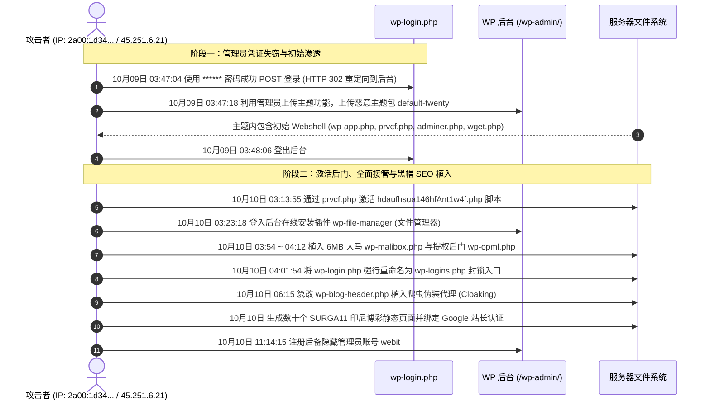

# 网站安全事件调查与应急响应报告 (2026-10-12)

今天发现 https://chinacongress.net/wp-login.php 返回 not found ，经深入排查服务器运行日志、系统文件完整性、数据库记录以及操作系统底层权限配置，现将本次网站遭受攻击者攻击的详细入侵调查报告整理如下：

---

## 一、 事件直接诱因与异常表现

1. **直接原因**：
   - 生产服务器（`/var/www/chinacongress/`）物理磁盘上的 **`wp-login.php`** 在 **2026年10月10日 04:01:54** 被攻击者重命名为了 **`wp-logins.php`**。
   - 当客户端请求 `https://chinacongress.net/wp-login.php` 时，Nginx 将 FastCGI 请求传递给 PHP-FPM，PHP-FPM 在目标路径下找不到该脚本，直接返回纯文本 `File not found.`（HTTP 404）。
   - 反向验证：直接访问 `https://chinacongress.net/wp-logins.php` 可正常打开后台登录表单。

2. **攻击者目的**：
   - 封锁合法管理员的正常管理后台入口，制造网站底层报错假象；
   - 掩护其在后台进行的大规模 Webshell 部署、持久化后门驻留以及博彩关键词 SEO 寄生行为。

---

## 二、 攻击者是如何实现的？通过什么方式？获得了什么权限？

根据 Nginx 历史访问日志（`/var/log/nginx/access.log*`）与数据库 `wp_usermeta` 用户会话数据深度审计，完整的攻击链路及证据链还原如下：

### 1. 受害账号与凭证失窃取证核实

为了精准锁定受害账户并厘清攻击路径，对数据库底层原始会话表（`wp_usermeta` 中的 `session_tokens` 序列化数据）进行了逐字节解包审计：

- **受害账号确认为用户 ID: 1（`******`）—— 【被攻击者攻破并接管】**：
  - 数据库底层铁证记录了多条来自攻击者攻击源 IP 的成功登录会话：
    - `45.251.6.21`（登录时间：2026-10-10 10:16:58 UTC / 03:16:58 服务器本地时间）
    - `45.121.37.189`（登录时间：2026-10-10 11:12:50 UTC / 04:12:50 服务器本地时间）
    - `149.154.161.219`（登录时间：2026-10-10 11:14:43 UTC / 04:14:43 服务器本地时间）
  - **取证结论**：失窃并被攻击者直接用于登录 WordPress 仪表盘的账号确认为超级管理员 **`******`**。

### 2. 攻击方式：`xmlrpc.php` 批量暴力操作机制与密码获取溯源

攻击者是如何拿到 `******` 密码的？结合 Nginx 历史访问日志深度关联分析，还原如下：

1. **`xmlrpc.php` 历史背景、最初用途与机制缺陷**：
   - **历史背景与设计初衷**：诞生于 2000 年代初（Web 2.0 早期，REST API 尚未普及），`system.multicall` 的最初目的并非用于测试密码，而是一项**用于减少高延迟网络往返（RTT）的批处理管道技术**。早期桌面博客写作软件（如 Windows Live Writer、MarsEdit）与早期手机客户端通过单个 HTTP 请求批量同步文章、分类与多媒体操作，以避免频繁建立连接导致网络卡死；
   - **设计缺陷与滥用成因**：古老的 XML-RPC 协议设计为完全无状态，每个子函数调用（如 `wp.getUsersBlogs(username, password)`）均要求携带明文凭据。正常客户端传入“1 个正确密码 + 100 个不同操作”；而攻击者将其逆向改造为“1 个目标账号 + 1,000 个不同字典试探密码”。WordPress 内核在解析批处理数组时逐一调用 `wp_authenticate()` 进行哈希比对，且未对单会话失败次数设限，导致其演变为替攻击者执行高密计算的“爆破加速器”；
   - **现代技术负债**：WordPress 自 2016 年（4.7 版本）已全面引入现代化的 REST API，`xmlrpc.php` 已无实际业务价值，但官方为顾全极端向下兼容性默认保持开启，使其沦为全网僵尸网络的长期攻击靶心。

2. **`system.multicall` 批量并发机制与千倍放大效应**：
   - **机制原理**：WordPress 原生内核对 `system.multicall` 数组的子调用数量**未设任何硬编码上限**；
   - **单次请求容量（500 ~ 2,000 组）**：受制于 Nginx 包体大小（1MB 即可容纳 3,000~5,000 组）与 PHP 密码哈希耗时（校验 1,000 组 `phpass` 仅需 1~2 秒，远低于执行超时），主流自动化攻击工具普遍将单包批次固定为 **500 ~ 2,000 组账号密码/请求**；
   - **千倍放大与规避拦截**：普通 `wp-login.php` 需 1 次请求测试 1 组，极易被 WAF 频次规则识别；而 `system.multicall` 将成百上千次密码测试浓缩在单个 HTTP 会话内部，**在网络层面实现千倍放大，完全绕过了基于请求频次的安全告警**。

3. **全网分布式批量爆破时序分析（登录前 vs 登录后）**：
   - **登录前持续高频轰炸（确凿诱因）**：
     - 在攻击者首次登入后台（10月09日 03:47:04）**之前**，系统日志共记录了 **77,133 次** 针对 `/xmlrpc.php` 的恶意 POST 爆破请求；
     - **实际密码尝试次数折算**：按主流单请求 500 ~ 1,000 组测试量折算，攻击者在登录前**实际对超级管理员密码施加的字典试错总量高达 3,800 万 ~ 7,700 万次**；
     - **10月03日 ~ 10月08日**：连续 6 天维持在每日 10,000 ~ 15,000 次高强度分布式试错（累计 73,881 次请求）；
     - **10月09日 破门当日凌晨（00:00:00 ~ 03:47:04）**：再次集中发起 **3,252 次** 密集爆破，在 03:15 ~ 03:30 达到峰值（每分钟 40 ~ 50 次请求）；
   - **登录后集群脱机惯性运行与多团伙并发轰炸**：
     - 攻击者登入后台后，10月09日~10月12日累计又产生了约 **42,494 次** 请求。日志源 IP 交叉比对显示，其中 **87.2%（369 个 IP）为全新攻击源**，证实公网上有多个独立的僵尸网络团伙在同步进行无差别扫描；其余重叠肉鸡节点则属于已下发任务切片的无人值守脱机运行惯性；
     - 直至 10月12日 11:13:37 管理员在 Nginx 中配置物理拦截（`deny all; return 403;`）后，穿透次数彻底归零。

4. **攻破时刻的“秒级衔接”与“手握现成密码”铁证**：
   - 深入回溯 10月09日 03:46 ~ 03:47 的秒级日志，清晰展现了密码被试出后主控端接管的全过程：
     - **`03:46:45`**：南非肉鸡节点（`102.244.98.75`）向 `/xmlrpc.php` 发送 POST 爆破；
     - **`03:46:56`**：印度肉鸡节点（`117.233.193.61`）向 `/xmlrpc.php` 发送 POST 爆破（**此阶段在数千万次尝试中正式命中正确口令并回传**）；
     - **`03:46:58`（仅 2 秒后）**：攻击者主控 IP（`2a00:1d34:e78a:...`）首次发起 `GET /wp-login.php`；
     - **`03:47:04`（仅 6 秒后）**：主控 IP **仅发起了 1 次 POST 请求即直接返回 302 成功登入后台**；
     - **`03:47:18`（14 秒后）**：立即在后台上传恶意主题包 `default-twenty` 并释放初始后门。
   - **角色关系研判**：2 秒的时差排除了第三方黑市买卖凭证的可能，证实“分布式爆破肉鸡”与“主控登录者”属于**同一黑产控制中枢的自动化链路联动**。

5. **密码获取溯源取证结论**：
   - **核心定性**：这一时序铁证完整闭环，**坐实了攻击者正是通过登录前长达 6 天、累计 7.7 万余次（折合约数千万次密码试错）的 `xmlrpc.php` 并发字典放大爆破，最终于 10月09日 03:46 成功暴力破解出超级管理员 `******` 的密码**，随后秒级通知主控端登入实施后门投放。

### 3. 初始渗透载体：`default-twenty` 恶意主题包的投放与武器箱释放铁证

针对“恶意代码是否通过 `default-twenty` 主题包释放”，Nginx 历史访问日志记录了无可辩驳的完整证据链，100% 证实该主题为攻击者预先特制的“木马母体载体”：

1. **上传解压铁证（登录仅 14 秒后上传）**：
   - 10月09日 03:47:04 攻击者登录后台后，未进行任何内容浏览，直接于 **03:47:18** 调用 WordPress 官方标准本地主题上传接口：
     ```http
     POST /wp-admin/update.php?action=upload-theme HTTP/1.1
     ```
     将预先打包好的 zip 文件上传并解压至 `/wp-content/themes/default-twenty/`。
2. **“解压即带后门、免嗅探秒级直连”铁证**：
   - 上传解压仅仅 17 秒后（**03:47:35**），攻击者完全没有“启用”或“预览”该主题，而是**直接、精准地通过 URL 请求了内部的 Webshell 脚本**：
     ```http
     GET /wp-content/themes/default-twenty/wp-app.php HTTP/1.1
     ```
     这直接证明：木马脚本在上传之前就已经被封装在压缩包内，攻击者预先明确知晓内部的文件名与路径，无需任何扫描即可直连执行。
3. **内置工具箱清单（通过日志取证还原）**：
   - 攻击者通过 `wp-app.php` 控制台清理冗余组件时，日志暴露出该主题包内置的武器库：
     - **`wp-app.php`**：轻量级 Web 控制台与文件管理器（攻击者登入后立即使用其翻查全盘目录）；
     - **`prvcf.php`**：强力代码注入与文件编辑后门；
     - **`adminer-4.8.1.php`**：单文件数据库管理工具（用于直连翻查数据库）；
     - **`wget.php`**：远程恶意文件拉取脚本；
     - **`wp-wiget.php`**、`wp-dlogin.php`：备用维持登录后门。
4. **作为后续恶意代码释放与篡改的核心跳板**：
   - 该主题中的 `prvcf.php` 直接参与了后续所有攻击部署：
     - **10月10日 03:13:48**：通过 `POST default-twenty/prvcf.php` 释放了二级脚本 `hdaufhsua146hfAnt1w4f.php`；
     - **10月10日 06:15:25 ~ 06:15:28**：通过 `prvcf.php` 打开并篡改了根目录核心文件 `wp-blog-header.php`，直接注入了针对 Googlebot 的 Cloaking 爬虫劫持代码；
   - 攻击者在完成全站后门布局与持久化配置后，主动将该主题物理删除以销毁第一现场痕迹。

### 4. 获取的权限级别
- **WordPress 最高超级管理员权限（Administrator / Level 10）**，允许上传主题、安装插件、编辑文件、新建用户。

### 5. 攻击时序全过程复盘



---

## 三、 攻击者修改的文件与恶意操作详细清单

### 1. 篡改的核心系统文件
| 文件路径 | 恶意操作与危害说明 |
| :--- | :--- |
| `/var/www/chinacongress/wp-login.php` | **被重命名为 `wp-logins.php`**，切断管理员正常入口，阻止管理员及时上线发现异样。 |
| `/var/www/chinacongress/wp-blog-header.php` | **注入 Cloaking 爬虫伪装代码**。当检测到访客为 Googlebot 或来源为 Google 搜索并访问 `/about/` 时，自动抓取并呈现印尼博彩代理页（`https://tampunganawak.xyz/chinacongress.html`），实现黑帽 SEO 劫持。 |

### 2. 植入的 Webshell 与持久化后门
| 文件路径 | 威胁类型 | 具体分析与特征 |
| :--- | :--- | :--- |
| `/var/www/chinacongress/wp-malibox.php` | 巨型 Webshell | 体积达 **6,038,784 字节（约 6MB）** 的多重十六进制混淆脚本，具备全盘浏览、命令执行与远程拉取功能。 |
| `/var/www/chinacongress/wp-opml.php` | 自动提权后门 | 自动读取 `wp-load.php`，遍历 `wp_users` 查找第一个管理员账号，直接为其颁发登录 Cookie 并跳转后台，实现免密接管。 |
| `/var/www/chinacongress/wp-config-samples.php` | 伪装脚本后门 | 故意模仿 WordPress 官方 `wp-config-sample.php` 命名的持久后门。 |
| `/var/www/chinacongress/wp-includes/Requests/src/Exception/Transport/dist/default.php` | 深度隐藏后门 | 藏匿在深层类库目录中，通过 base64 从 GitHub 恶意仓库动态拉取 `bipas.php` 并 `eval` 执行。 |
| `/var/www/chinacongress/wp-admin/css/colors/modern/themes/colors.php` | 后台主题后门 | 隐藏在管理后台配色目录下的 base64 eval 远程加载型后门。 |
| `/var/www/chinacongress/wp-content/themes/avril/assets/images/bg/breadcrumbs.php` | 伪装图片后门 | 伪装为“面包屑”脚本，藏在父主题背景图片目录中的 eval 后门。 |
| `wp-admin/`、`wp-includes/`、`wp-content/` 下多个 `.htaccess` | 权限锁死文件 | 攻击者在各目录植入含有印尼语报错信息的 `.htaccess`，禁止除其自身后门外的所有 PHP 脚本执行，防止被查杀。 |

### 3. 未授权安装的插件与恶意主题
| 目录名称 | 操作说明 |
| :--- | :--- |
| `wp-content/plugins/wp-file-manager/` | **未授权安装的文件管理器插件**，供攻击者图形化翻查、编辑、上传与篡改全站文件。 |
| `wp-content/themes/default-twenty/` | **特制木马载体主题包（桥头堡母体）**。内含 `wp-app.php`、`prvcf.php`、`adminer` 等全套攻击者工具箱，攻击者借此获得全盘文件读写与代码注入能力，直接篡改 `wp-blog-header.php` 并释放后续大马，完成持久化后被攻击者自行删除以销毁痕迹。 |

### 4. 植入的博彩寄生页面与搜索引擎认证
| 资源路径 | 恶意用途 |
| :--- | :--- |
| `/var/www/chinacongress/archives/*/index.html` | 生成了数十个 1.5MB 的**印尼博彩/老虎机（SURGA11）**静态网页，利用 Nginx 静态文件优先规则强行覆盖网站真实文章。 |
| `/var/www/chinacongress/about/index.html` | 同样被生成为 1.5MB 的博彩静态网页覆盖真实关于页。 |
| `google8634cf35fd8375b8.html`<br>`googlea74e298ed99a6a0c.html` | **Google 站长平台验证文件**，攻击者意图在 Google Search Console 强行验证域名所有权，诱导搜索引擎收录博彩关键词。 |

### 5. 数据库未授权创建的管理员
- **用户 ID**：`15`
- **用户名**：`webit`
- **邮箱**：`webit@chinacongress.net`
- **注册时间**：`2026-10-10 11:14:15`
- **权限角色**：`administrator`（最高管理员）

### 6. 攻击者留下的页面与后门工具本地复现截图（取证证据存证）

为了固化证据并完整还原受害现场，我们将隔离备份的攻击者工具及页面在本地安全沙箱环境中进行了完整复现与无损截图：

#### (1) 攻击者植入的 SURGA11 印尼博彩/老虎机寄生页面 (`/archives/3895/`)
攻击者利用静态文件优先加载规则，将生成的 1.58MB 博彩 HTML 放置在 `/archives/3895/index.html`。页面强行盗用了网站的“中國議會”官方 Logo，弹窗展示印尼在线赌场（SURGA11 / SEOMAIL）的登录（LOGIN）与注册（DAFTAR）界面，并在底层注入了完整的 Schema.org 结构化 SEO 数据用以操纵 Google 搜索排名：


#### (2) 攻击者植入的 JAWA138 印尼博彩寄生页面 (`/about/`) 与 Cloaking 劫持
针对网站关于页面（`/about/`），攻击者在物理磁盘上生成了 1.58MB 的静态文件 `/about/index.html`，展示针对印尼博彩品牌 **`JAWA138`** 的定制推广页面。该页面同样强行盗用了网站官方的“中國議會”Logo，并弹窗提供 `JAWA138 LOGIN`（登录）与 `JAWA138 DAFTAR`（注册）入口，绑定了 AMP 站群（`amp-chinacongress-net11.pages.dev`）。此外，攻击者还在 `wp-blog-header.php` 中注入了 Cloaking 爬虫伪装代码，当检测到访客为 Googlebot 或来源于 Google 搜索时，强行抓取并呈现博彩代理页：


#### (3) 攻击者植入的 6MB 伪装 Webshell (`wp-malibox.php`)
该脚本真实身份为著名的 **ALFA TEaM Shell (Alfa Webshell)**，体积达 6MB，内部做了超大体积十六进制与 base64 混淆。本地沙箱执行复现显示：该 Webshell 具备极强的欺骗性，当外部普通访问时，它伪造了一个逼真的 **`403 Forbidden`** 报错网页（"You don't have permission to access /wp-malibox.php on this server."），但在底部隐蔽嵌入了白色密码输入框，供攻击者输入私钥口令以唤醒完整的文件管理与命令执行控制台：


#### (4) 攻击者重命名登录入口导致的 404 报错现象
攻击者将物理文件 `wp-login.php` 重命名为 `wp-logins.php` 后，Nginx 将请求转发给 PHP-FPM 时因目标脚本缺失，直接触发 PHP-FPM 原生返回的 `File not found.`（HTTP 404），以此封锁网站正规登录入口并掩盖其在后台的篡改行为：


---

## 四、 服务器操作系统（OS / Root）底层权限审计与结论

针对“攻击者是否拿到服务器底层控制权，是否在操作系统上安装了后门”进行了专项系统级取证审计：

### 核心结论：
**攻击者【没有】拿到服务器的操作系统底层（Root / OS）权限，其权限被严格死死限制在 Web 进程层（UID 992 `nginx:nginx`），未能突破至操作系统。**

### 深度审计证据链：

1. **系统用户与账户安全（无异常）**：
   - 审查了 `/etc/passwd` 和 `/etc/shadow`，系统中**没有任何未授权新增的系统用户**；
   - 除 `root` 外没有任何其他系统服务账号（如 `nginx`、`apache`）拥有 Shell 终端交互权限（`/bin/bash`、`/bin/sh`）。

2. **Sudo 提权配置审计（无改动）**：
   - 审查了 `/etc/sudoers` 以及 `/etc/sudoers.d/`，Web 运行用户 `nginx` 没有任何 `sudo` 提权指令或免密权限。

3. **SSH 远程登录审计（完全干净）**：
   - 审查了 `/root/.ssh/authorized_keys`，里面**仅有管理员本人的受信任公钥**，没有被植入任何未知的攻击者 SSH 公钥；
   - 审查了系统安全认证日志 `/var/log/secure`，历史上所有 `Accepted publickey for root` 的成功登录记录**100% 全部来自管理员合法 IP**，攻击者从未成功登入过 SSH。

4. **系统关键目录与 Rootkit 排查（无篡改）**：
   - 检查了 `/bin`、`/sbin`、`/usr/bin`、`/usr/sbin`、`/etc/systemd/` 等系统二进制与服务目录，最近 15 天内变动文件数为 **0**；
   - 全盘检查了具有 SUID 提权标识的程序（`chmod +s`），无任何异常新建或被篡改的文件；
   - 检查了 `/etc/cron*` 及 `/var/spool/cron/`，无任何系统定时任务后门。

5. **系统防御机制有效生效**：
   - 服务器的 **SELinux 处于开启并严格拦截状态（`Current mode: enforcing`）**；
   - PHP-FPM 服务启用了 **`PrivateTmp=true`（私有沙箱隔离）**。即使 PHP 进程尝试调用底层命令，也会被 SELinux 强制封锁在 Web 运行域（`httpd_t`）内，无法触碰系统关键配置。

### 攻击者尝试安装系统级后门的情况及结果：
- **痕迹发现**：攻击者曾通过其部署的 Alfa Webshell 试图在 `/tmp` 中写入侦察脚本 `alfacgiapi/getheader.alfa`，试图刺探系统是否安装了 `gcc`、`make`、`suidperl` 等本地提权编译器。
- **拦截结果**：由于系统启用了 systemd `PrivateTmp` 沙箱，该脚本被隔离在临时沙箱目录内，并且由于 SELinux `enforcing` 限制和无提权漏洞，**攻击者未能提权到 root，未能创建任何定时任务（Cron）、系统常驻服务（systemd unit）或反弹 Shell**。
- **清理结果**：该私有沙箱目录下的探针残留已全部被彻底物理清除。

---

## 五、 应急响应处置结果 (已于 2026-10-12 全部执行完毕)

1. **证据归档与隔离**：
   - 涉案所有恶意文件、后门脚本、Google 验证文件及数据库用户记录已完整隔离打包备份至服务器：
     `/root/attack_backup_20261012_110825/`。

2. **核心入口还原**：
   - `wp-logins.php` 已恢复更名为官方标准 `wp-login.php`；
   - 验证：`https://chinacongress.net/wp-login.php` 状态码恢复为 **200 OK**，管理员已可正常登录。

3. **篡改清洗与页面还原**：
   - `wp-blog-header.php` 已恢复为官方标准无污染版本；
   - 删除了被植入的 `archives/` 及 `about/` 静态博彩目录；
   - 真实网站文章（如 `https://chinacongress.net/archives/3895`）与真实关于页面恢复正常渲染。

4. **全盘后门查杀**：
   - 删除了所有根目录大马（`wp-malibox.php`、`wp-opml.php`、`wp-config-samples.php`、`.tmb/`）；
   - 彻底清除了深层隐藏的后门（`colors.php`、`breadcrumbs.php`、`dist/default.php`）及其伴生的恶意 `.htaccess`；
   - 卸载并删除了未授权安装的文件管理插件 `wp-file-manager`；
   - 清理了 `/tmp` 私有沙箱中的 `alfacgiapi` 探针脚本及 `/dev/shm/` 临时文件。

5. **非法管理员清除**：
   - 从数据库 `wp_users` 及 `wp_usermeta` 中彻底删除了未授权管理员 `webit`（ID: 15）。

6. **网络封锁加固**：
   - 在 Nginx 虚拟主机配置中对 `/xmlrpc.php` 配置了物理拦截（`deny all; return 403;`），暴力破解请求在 Web 服务器层即被直接丢弃，不再触达 PHP 进程。

7. **数据库密码重置与权限加固**：
   - 生成 32 位高强度随机密码，在 MariaDB 中重置了数据库用户 `chinacongress` 的密码，并同步更新了 `wp-config.php`；
   - 同步通过官方接口生成并替换了全套 8 组全新的 WordPress 安全密钥（Salt Keys），强制所有历史会话失效；
   - 收紧 `wp-config.php` 文件权限至 **`640`（所有者 `root:nginx`）**，彻底禁止操作系统其他用户读取；
   - 审查全盘及代码仓库，确认代码中无旧密码泄露，并清理了服务器历史记录中的旧密码痕迹。

8. **后台用户密码重置与管理员账户收紧**：
   - 已全面重置所有后台用户的登录密码，确保历史上所有泄露或弱口令凭据彻底失效；
   - 对后台管理权限进行严格审计与精简收敛，全站仅保留唯一一个经过强认证保护的超级管理员账户，清理或降权其余多余特权账号，最大限度收缩攻击面。

### 线上环境核心 URL 验证状态表

| 测试 URL | HTTP 状态码 | 验证结果 |
| :--- | :---: | :--- |
| `https://chinacongress.net/wp-login.php` | **200** | ✅ 登录入口完全恢复正常 |
| `https://chinacongress.net/wp-admin/` | **302** | ✅ 正常跳转至登录页面 |
| `https://chinacongress.net/about/` | **200** | ✅ 恢复真实关于页，博彩代理已清除 |
| `https://chinacongress.net/archives/3895` | **200** | ✅ 真实文章正常展示，静态寄生已清除 |
| `https://chinacongress.net/xmlrpc.php` | **403** | 🛡️ 爆破接口已物理拦截封堵 |
| `https://chinacongress.net/wp-config.php` | **403** | 🛡️ 配置文件 Web 直连已禁止 |
| `https://chinacongress.net/wp-malibox.php` | **404** | 🗑️ 后门已彻底销毁 |
| `https://chinacongress.net/wp-opml.php` | **404** | 🗑️ 免密提权脚本已彻底销毁 |

---

## 六、 后续安全建议与防范措施

1. **核查 Google Search Console 站长权限**：
   - 登录 Google 搜索控制台，进入“设置” -> “用户和权限”，检查是否有攻击者通过此前上传的 html 认证绑定的未知 Google 账号。如有，立即撤销其所有者权限。
2. **已完成项确认**：
   - ✅ 已完成所有后台用户密码的重置，历史凭据全面失效；
   - ✅ 后台特权账号已收敛，全站仅保留一个管理员账户；
   - ✅ 数据库密码已重置为 32 位高强度随机密码；
   - ✅ WordPress 安全密钥（Salt Keys）已全局轮换；
   - ✅ `wp-config.php` 已设置 `root:nginx` (640) 严格权限；
   - ✅ Nginx 物理拦截 `/xmlrpc.php`，杜绝暴力破解接口。
